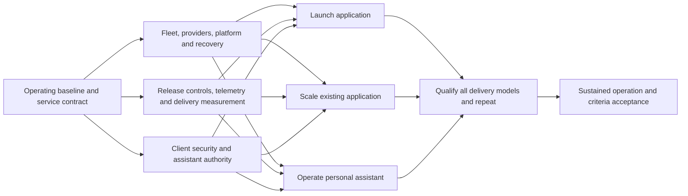

# PUNI client delivery readiness implementation roadmap

> **For agentic workers:** use `subagent-driven-development` or `executing-plans` when an implementation packet is authorized. This roadmap organizes the work; each packet must first reconcile its existing OpenSpec contract or create the required change and ordered TDD slices. Checklist entries below are planned work, not completed implementation.

**Goal:** satisfy the agreed PUNI assessment criteria for launching applications,
scaling existing applications, and delivering personal assistants, across shared,
dedicated, client-owned and hybrid delivery models.

**Architecture:** complete and qualify existing infrastructure and delivery mechanisms,
then package them into repeatable client journeys. Keep general node management,
cloud provisioning, cluster services, application behavior and assistant authority
as distinct contracts. Reuse existing code and acceptance artifacts before adding
new implementations.

**Tech stack:** existing Bun/Nx workspace, Hetzner, Ansible, Terragrunt, k3s/Flux,
Compose where already deployed, Dagger, existing telemetry/accounting, WBS auth and
OpenClaw. Add AWS provisioning and reusable client modules through their own changes.

**Spec:** [approved assessment scope](../../../puni-assessment.md).
**Baseline:** [assessment and evidence](../../findings/puni-assessment-2026-10-21/report.md)
at `4151532121633d978beb67ab52b3eb748285cd8e`, 2026-10-21. Live observations are dated
evidence to refresh before work, not a promise that the same state persists.

## Global constraints

- Infrastructure is a deliverable; retain general fleet management and AWS in full scope.
- Assess and accept each of the three client journeys separately.
- Qualify shared, dedicated, client-owned and hybrid models explicitly; one pilot does
  not certify every model.
- Separate implementation, operational activation, verification and document reconciliation.
- Bun and Nx only. Follow [AGENTS.md](../../../AGENTS.md), including additive migrations,
  complete rollback-ledger comparison, and observed negative proofs for changed safety checks.
- Source existence, checked tasks and successful process exits do not establish readiness.
- Preserve existing production while qualifying k3s; this is not a new Compose-first
  architecture or permission to abandon the existing k3s plans.
- The present deliverable is the roadmap. No infrastructure apply, release, credential
  change or recovery drill is performed by writing it.

## How to read and use the plan

1. This page gives milestones, order, estimated effort and decisions.
2. [Work packages](2026-10-21-puni-readiness/work-packages.md) define W01–W27:
   concrete steps, existing owners/artifacts, deliverables and completion evidence.
3. [Criteria coverage](2026-10-21-puni-readiness/criteria.md) maps every scope area to
   closing packages and acceptance evidence. It also defines the 3 × 4 journey/model
   acceptance matrix.

All packages start **planned**. No owner has been assigned by this document; role
names identify accountability that W01 must allocate. Default capacity assumption is
**one accountable operator/engineer (you), assisted by coding agents**. Agents can
prepare independent changes in parallel; operator attention, shared-host gates,
provider access and acceptance environments remain constrained resources.

## Milestones and what becomes possible

| Milestone                                             | Packages                   | Outcome and exit gate                                                                                                                                                                                                                            | Engineering effort               |
| ----------------------------------------------------- | -------------------------- | ------------------------------------------------------------------------------------------------------------------------------------------------------------------------------------------------------------------------------------------------ | -------------------------------- |
| M0 — Establish the operating baseline                 | W01–W05                    | Named service/owner contracts; scheduled backups and restore proven; production provenance reconciled; merge checks enforced; current estate/spec evidence available. Unresolved recovery, identity or enforcement findings keep this gate open. | 8–20 days                        |
| M1 — Operate the infrastructure through its lifecycle | W06–W11, W16               | Standalone and cluster node lifecycle, Hetzner and AWS resource lifecycle, platform dependencies, credential lifecycle and complete restore coverage proven in the declared environments.                                                        | 50–100 days                      |
| M2 — Deliver and measure changes safely               | W12–W15, W17–W21, W24, W28 | Reusable CI/CD and app starter/auth; observable health and delivery cost; client boundaries and abuse behavior qualified; agent throughput measured and agent coordination executable; OpenClaw installation and authority packaged.             | 65–129 days                      |
| M3 — Complete the three client journeys               | W22, W23, W25              | One new app launched, one existing app measurably scaled, and one assistant operated/recovered/offboarded; each has client acceptance, time/cost records and handover.                                                                           | 16–32 days                       |
| M4 — Prove repeatability and ongoing service          | W26–W27                    | All 12 journey/model cells qualified, second-operator repeatability demonstrated, service observation window and complete criteria review passed.                                                                                                | 10–20 days plus observation time |

Milestones group deliverables; they are **not five sequential queues**. M1 and M2
work can overlap according to the package dependency table. AWS is mandatory for
full completion, but does not block the first Hetzner pilot. Assistant preparation
does not wait for the proposed Twilight UI/control plane. Scale and assistant
acceptance do not depend on finishing the new-app pilot.

## Package sequence, accountability and effort

Dependencies below are required **before accepting the package**. Reading, design
and isolated fixtures may begin earlier if they do not invent an unresolved contract.
Numbers are preliminary engineering-day ranges, not measured execution times.

| ID  | Work                                                                 | Depends on                             | Accountable role              | Engineer-days |
| --- | -------------------------------------------------------------------- | -------------------------------------- | ----------------------------- | ------------- |
| W01 | Fix service scope, targets, delivery models and owners               | —                                      | Service owner                 | 2–4           |
| W02 | Diagnose and restore scheduled backup protection                     | —                                      | Recovery operator             | 1–5           |
| W03 | Reconcile and prove production release identity                      | W02, W04 if replacement is necessary   | Release/build owner           | 1–3           |
| W04 | Enforce merge gates and reliable CI verdicts                         | —                                      | Repository administrator      | 2–4           |
| W05 | Refresh estate evidence and reconcile existing work                  | —                                      | Platform/knowledge owners     | 2–4           |
| W06 | Manage the full node fleet, including standalone hosts               | W01, W05                               | Fleet owner                   | 8–16          |
| W07 | Qualify Hetzner provisioning and infrastructure state                | W01, W05                               | Cloud owner                   | 5–10          |
| W08 | Qualify k3s node maintenance, expansion and recovery                 | W06, W07                               | Fleet owner                   | 6–12          |
| W09 | Complete platform dependencies and service onboarding                | W07, W08                               | Platform owner                | 6–12          |
| W10 | Cover every persistent store with protected recovery                 | W02, W06, W09, W16                     | Recovery owner                | 8–16          |
| W11 | Implement and qualify AWS resource lifecycle                         | W01, W05, W06, W16                     | Cloud owner                   | 12–24         |
| W12 | Qualify reusable build, promotion and recovery pipelines             | W03, W04, W09, W16                     | Delivery owner                | 10–20         |
| W13 | Connect health, logs, traces and alerts to real behavior             | W01, W05, W09                          | Observability owner           | 6–12          |
| W14 | Collect delivery, cost and human-effort metrics                      | W01, W03, W04                          | Delivery operations owner     | 6–12          |
| W15 | Qualify identity, organization and client isolation                  | W01, W05, W09, W12, W16                | Security/application owners   | 7–14          |
| W16 | Manage secrets, access, retention and client exit                    | W01, W05                               | Security/platform owners      | 5–10          |
| W17 | Qualify abuse protection and resource contention                     | W09, W13, W15                          | Security/performance owners   | 4–8           |
| W18 | Package auth and prove second-application adoption                   | W15, W16                               | Shared-module owner           | 8–15          |
| W19 | Deliver a versioned client starter and upgrade path                  | W04, W09, W12, W18, W20                | Developer-experience owner    | 6–12          |
| W20 | Complete a modularity and artifact-quality pilot                     | W01, W04                               | Architecture/knowledge owners | 6–12          |
| W21 | Measure parallel-agent delivery and set supported concurrency        | W14, W19, W20                          | Delivery operations owner     | 6–12          |
| W28 | Make agent coordination executable: identity, admission, termination | W04, W14, W16                          | Dash owner + security lead    | 5–10          |
| W22 | Accept the new-application journey                                   | W10, W12, W13, W14, W15, W17, W18, W19 | Client/application owner      | 2–4           |
| W23 | Accept the existing-application scaling journey                      | W08, W10, W12, W13, W14, W15, W17      | Client/performance owner      | 8–16          |
| W24 | Package OpenClaw installation and authority                          | W01, W06, W16; telemetry slice below   | Assistant/security owners     | 6–12          |
| W25 | Accept assistant operation, recovery and handover                    | W14, W24; recovery/abuse slices below  | Client/assistant owner        | 6–12          |
| W26 | Qualify all delivery models and repeat independently                 | W11, W21, W22, W23, W25                | Service/acceptance owners     | 8–16          |
| W27 | Observe ongoing operation and close every criterion                  | W26                                    | Service owner                 | 2–4           |

W24 may use W13's accepted **host/application telemetry slice** without waiting for
cluster telemetry. W25 similarly needs W10's **assistant-state recovery slice** and
W17's **assistant attack/resource envelope**, implemented and proved against its actual
substrate. These are required receipts, not waivers of health, recovery or security.
They can run before the full cluster/application packages; only a WBS connector also
requires W15's applicable WBS isolation proof. W26 still requires complete W09/W10/W13/
W15/W17 acceptance through its application-journey dependencies. A standalone assistant
pilot therefore does not wait for unrelated Kubernetes or WBS work.

The first application's longest structural chain runs through fleet/provider →
platform → release → client isolation → reusable auth → starter → journey acceptance.
Restore, abuse protection and observability must join before acceptance. An assistant
can advance through host lifecycle/secrets → assistant authority and telemetry →
recovery/abuse/accounting → its own pilot. AWS and the agent benchmark join full-scope
qualification later. With one operator, resource contention can dominate these paths;
none is a reliable calendar forecast until owners, access and target decisions are fixed.

### Estimate meaning and scheduling limits

The sum is **149–301 engineering days**, before attended operations and external wait.
This is an initial sizing hypothesis for completing the entire scope, including AWS,
auth extraction and 12-cell qualification; it is not a quotation or an agent-runtime
forecast. It includes implementation, tests, review and documentation, assumes reuse
of assessed code, and excludes replacement of the WBS database or construction of the
full proposed Twilight control plane. If a chosen service target needs either, W01/W23
must expose that additional dependency and re-estimate rather than silently include it.

Reserve a separate **24–48 attended operator-days** across the portfolio: M0 2–4,
M1 10–20, M2 5–10, M3 4–8, M4 3–6. These are hands-on account/configuration/drill/client
windows, excluded from the engineering figures; the same person doing both must add
them. Shared drills should have one ledger entry, even when several criteria use it.
Provider/IdP access, DNS propagation, client calendars and policy approvals are external
wait, not free engineering capacity. W27 proposes a 30-day service observation window;
it may overlap later work only while the measured configuration stays applicable.
Retention expiry, key overlap and billing require their actual windows, including
at least 31 calendar days where that retention policy applies. These estimates have
low confidence until M0 resolves current state and W01 freezes the supported catalogue.

Re-estimate after M0, after the first infrastructure activation and after the first
end-to-end journey. Track actual engineering effort, operator minutes and waiting
separately in W14. Do not divide these ranges by the number of agents. W21 supplies
the evidence for any justified concurrency adjustment.

## First execution tranche

Start the following as five bounded deliverables. This is the first work queue, not
a claim they can all finish within one week:

- [x] W02: spend the first diagnostic half-day identifying the failing backup step,
      covered stores and newest usable generation; preserve evidence, then size the repair
      and isolated restore. Escalate a missing recovery generation immediately to its owner.
      Done 2026-10-23: [W02 resolution](../../findings/puni-assessment-2026-10-21/live-evidence.md#w02-resolution--2026-10-23).
- [ ] W03: collect the exact routed runtime/image/state/build/gate chain for every tier;
      identify which claims can be proved. Do not repair metadata by guessing a SHA.
- [ ] W04: determine required checks and bypass rules; apply and verify the chosen
      repository policy using an intentionally failing disposable PR.
- [ ] W05: acquire authorized read access for current cluster/provider evidence and
      classify existing change slices as implemented, activation owed, proof owed or superseded.
- [ ] W01: settle the service contract decisions below and assign named accountable
      owners. Preparation can run alongside incident diagnostics; acceptance needs the owners.

Then begin W06/W07/W16 in the infrastructure/security lane, W14/W20 in the delivery
lane, and source/fixture preparation for W12/W13/W24. One person should schedule
attended operations serially; independent agent edits need distinct file ownership.
All heavy host gates use the existing lock and an isolated gate worktree.

## Decisions to settle without stopping roadmap preparation

| Decision                            | Recommended starting position                                                                                                                                                                               | Required before                                                          |
| ----------------------------------- | ----------------------------------------------------------------------------------------------------------------------------------------------------------------------------------------------------------- | ------------------------------------------------------------------------ |
| First pilot workload/model          | One representative Bun/TypeScript web app in a dedicated PUNI-operated environment; retain all other models in W26                                                                                          | W01 acceptance / W19 contract                                            |
| Supported systems                   | Explicit Linux/amd64 host and container-runtime catalogue based on existing contracts; record adapters required by named existing-client stacks                                                             | W06, W09, W23                                                            |
| Availability/recovery/abuse targets | Versioned per-service values for availability window, latency/error/load envelope, maintenance budget, RPO/RTO, backup retention, attack envelope and cost ceiling; agree before running acceptance         | W10, W13, W17, W22–W27                                                   |
| Fast onboarding                     | Measure from prepared accounts/DNS/credentials/artifact to usable service; propose ≤60 minutes elapsed and ≤15 minutes hands-on for a standard service. Repository/client intake time is a separate measure | W09/W19 acceptance; target must be accepted or explicitly revised in W01 |
| AWS catalogue                       | Name the first account/region and required network, IAM, compute, storage, secret, DNS and telemetry resources; include create/import/change/retire and state protection                                    | W11 design; no AWS pass based on S3-compatible Hetzner alone             |
| Authentication methods              | Auth0 plus a second real standards-based OIDC provider; explicitly decide password/social/enterprise provisioning requirements                                                                              | W18 contract                                                             |
| Assistant trust model               | Separate client authority, credentials and state; propose one gateway instance per client even when infrastructure/services are shared                                                                      | W24 contract; reuse of a shared gateway requires its own isolation proof |
| People and capacity                 | You plus agents as the baseline; name operator/reviewer/client contacts and support windows, replacing role labels                                                                                          | W01 acceptance and any scheduled operational work                        |

These are proposed planning defaults, not accepted runtime policy. Missing values block
the relevant acceptance, not unrelated work. Changes to targets must be recorded before
testing; lowering a threshold after a failed test requires a service-owner decision and
retained failure evidence. Removing a delivery model, provider or client journey is a
scope change, not a way to complete this plan.

## Completion and evidence rules

For each package, retain the source/spec revision, environment identity, command,
assertion, pass/fail output, changed-guard negative proof where applicable, owner,
elapsed/operator effort and links to downstream criteria. Evidence lives in the owning
OpenSpec change's `verify.md` or an operational evidence record linked from it.
Only W01/W05 decision and reconciliation records can close by document review alone.
The other packages require their listed implementation and/or operational evidence.

W26 completes the matrix in [criteria coverage](2026-10-21-puni-readiness/criteria.md).
W27 requires every criterion to have fresh, applicable evidence and a current owner,
and every journey to have acceptance and handover. An unsupported matrix cell remains
open unless the user explicitly changes the scope. A passing code gate, a pilot demo,
or a proposed plan cannot close the full readiness objective.

This roadmap is complete as a planning artifact when its coverage, dependencies,
estimates, ownership and acceptance rules are internally consistent. Completing this
document does not mark W01–W27 or the platform readiness criteria complete.

## Planning verification — 2026-10-21

The coordinating reviewer mapped the scope to 66 criteria. Three domain reviewers
checked infrastructure/recovery, delivery/CI/CD, and security/auth/assistant coverage;
their dependency and acceptance-boundary corrections are incorporated.

Local verification checks formatting, link-target existence, unique package/criterion
identifiers, the 12-cell matrix, declared dependency cycles and effort sums. The graph
check covers full-package dependencies; the required assistant slices and conditional
production replacement are additionally reviewed in the text. These checks validate
the plan's structure, not the readiness of any service.

No implementation tests, full host gate, fresh provider/cluster readback, deployment,
recovery drill or client acceptance were run for this documentation-only roadmap.
The assessment's dated runtime evidence remains its baseline, to refresh during W05
and before relevant operational work. External links and existing-document anchors
are not validated by the local link-target check.
