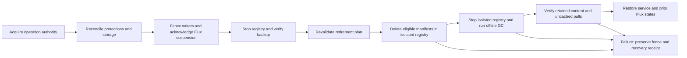

## Context

**Design only, 2026-10-25. No safeguards in this change are activated yet.**
The [operational registry](../../../docs/infra/registry.md) runs Distribution 2.8.3.
A fresh host inspection found 101 MiB in its directory, on the 150 GiB root
filesystem with 115 GiB available. Its 50 GiB `puni-retain` PVC uses local-path;
all three installed StorageClasses use the same provisioner and no CSI driver is
installed. The request is not a capacity boundary. There is no automatic image
retirement; registry backups currently retain all snapshots.

Dagger publishes tiers directly and writes the latest `release.json` only after
all succeed. That partial tier record is not a durable release history. Registry
copy already traverses manifests and checks blob digests. Kubernetes releases
have durable transaction journals; Compose swaps retain exact outgoing digests.
The backup runner already proves root and platform Flux suspension before stopping
the registry. Reuse those boundaries; do not infer protections from running Pods.

## Goals / Non-Goals

**Goals:** bounded registry writes, predictable retirement, preserved deployment
and recovery obligations, and an implementation plan covering every registry writer.

**Non-Goals:** product migration in this delivery, live image deletion, changing
unrelated Flux stages, registry high availability, or unlimited release history.
Registry limits do not bound Docker, containerd or Dagger caches on other hosts.

## Decisions

### Capacity and thresholds

Use a dedicated block-backed filesystem, maximum 50 GiB, exposed through a retained
PV with enforced backing capacity. The implementation must provision and verify
that storage; existing local-path classes do not qualify. Match filesystem identity,
mount, capacity and node ownership before writable startup. Refuse missing mounts;
never create registry directories on the underlying root filesystem as a fallback.
A quota-backed implementation requires equivalent saturation and missing-quota
proofs before substituting for the dedicated filesystem.

Let C be the smaller of configured maximum and actual usable filesystem capacity.
Read allocated filesystem bytes and free inodes, including upload staging and
metadata; do not sum advertised image sizes or count shared layers repeatedly.

| Condition                                                                         | Required behavior                                |
| --------------------------------------------------------------------------------- | ------------------------------------------------ |
| Used bytes >= 70% C or inode use >= 70%                                           | Warn with measured remaining capacity            |
| Used bytes >= 80% C or inode use >= 80%                                           | Request retirement; nightly retirement also runs |
| Used bytes + reservations + new publication envelope >= 90% C                     | Refuse that publication before upload            |
| Actual usage or inode use >= 90%, host root free < 20 GiB, or measurement invalid | Fence new writes and report the exact reason     |
| Usage and inode use < 70%, root reserve restored, maintenance verified            | Permit explicitly reconciled reopening           |

The remaining 10% is recovery headroom, not extra publishing capacity. Pressure is
checked every minute and synchronously at publication admission. The hard filesystem
boundary remains effective if the process or monitoring fails. A polling cutoff is
not an exact physical 90% cap: existing in-flight or out-of-workflow pushes can
overshoot until fenced. They still cannot escape the filesystem boundary. Current
htpasswd authentication has no per-account push restriction; do not claim otherwise.

Initially admit one publisher/import at a time. Before transfer, obtain a conservative
upper bound for all exported OCI content plus upload staging and metadata, without
assuming deduplication savings. Bound export scratch storage separately on the
builder. A missing byte/inode envelope is an admission error. The aggregate reserved inode
envelope must also fit below the 90% inode threshold. Recheck actual capacity
at each artifact boundary; oversize attempts fail visibly and are reconciled as
partial publications. Reservations survive worker crashes until server-side uploads
are quiesced; lease expiry alone cannot authorize reuse of their capacity.

### Protection authority and workflow contract

Add a durable registry journal behind `tool-fleet`, with pure policy planners and
thin host IO adapters. Runtime authority belongs to Twilight Dash's execution
boundary; Twilight Burokrat can validate configuration and evidence, not authorize
runtime deletion. Deploy and publish callers use one authenticated operator boundary
rather than directly editing journal files. Initially this boundary is an owner-only
Bun CLI invoked over the existing authenticated SSH operator path; no new public
service or registry authentication scheme is required.

Journal records contain registry identity, monotonic revision, product, operation,
owner, exact repository/digest references, publication receipt times, complete release
bundles, protection reasons, bounded publication reservations and maintenance phase.
Writes are atomic and durable before acknowledgement. Use a separate bounded 1 GiB
journal filesystem with its own 90% refusal threshold; registry ENOSPC must not
prevent recording a failed operation. Compact only reconciled historical records,
never current protections, recovery records or unresolved operations. Back up the
journal with the matching content snapshot.

| Workflow                           | Obligation before making an image reference usable                                                                        | Safe release of protection                                                                  |
| ---------------------------------- | ------------------------------------------------------------------------------------------------------------------------- | ------------------------------------------------------------------------------------------- |
| Publish / mirror / import          | Reserve space; register candidate digests and dependencies; verify upload; persist complete bundle before success receipt | Reconciled failure or abandonment starts seven-day retention; promotion transfers ownership |
| Promotion                          | Protect the complete candidate bundle before changing desired environment revision                                        | Transfer to deployment and release-history owners atomically                                |
| Deploy / restart / scale from zero | Protect desired, observed and candidate images before changing workload intent                                            | Candidate and outgoing protections remain through health verification and commit            |
| Rollback                           | Protect target and current release before initiating rollback                                                             | Current plus two previous successful environment releases stay protected by default         |
| Failed deployment / recovery       | Preserve every image named by incomplete journals and recovery instructions                                               | Explicit reconciled recovery, never a timeout or a terminal error label alone               |
| Environment retirement             | Prove desired references removed, consumers gone and rollback/recovery work settled                                       | Release that environment's protections only; other owners remain                            |
| Operator pin / restore             | Record attributable owner and reason before promising recoverability or serving restored content                          | Explicit owner release after inventory reconciliation                                       |
| Backup / image retirement          | Acquire common operation authority and reconcile all protections                                                          | Release maintenance ownership only after verified completion                                |

Registered consumer adapters inspect desired Git/Flux images, Kubernetes workloads
including scaled-to-zero controllers and jobs, live releases and recovery journals,
Compose active and idle colours, and solver/worker image locks. Every external product
pipeline must enroll before adoption. A successfully running cached container does
not prove its image can be deleted. Inventory is complete only if every registered
consumer reports against the current operation revision. Unknown owners or digests
freeze retirement until enrolled or explicitly reconciled.

Protect-before-reference is a protocol: a workflow commits its protection before
writing desired state or starting a consumer. Retirement holds the common authority
while checking and deleting; protection changes cannot interleave. Long deployments
hold durable protections, not a host lock throughout the rollout. An operation trying
to add or change references during maintenance waits or fails before touching the
consumer. An admin bypass is outside the supported workflow and must be reconciled
before automatic deletion resumes.

### Retirement policy

Keep the newest ten successfully promoted complete release bundles per product,
ordered by trusted promotion receipt (stable operation ID breaks timestamp ties).
Keep all image protections in addition. Per-environment current plus two prior
successful releases are an independent minimum, even if older than the global ten.
An older successful bundle is eligible once outside both sets. A never-promoted
publication is eligible seven days after its reconciled completion or abandonment.
Do not use image-authored timestamps, mutable tags or process age as authority.

Retire eligible bundles oldest first, then their now-unreferenced manifests. Shared
manifests and blobs remain if any retained owner needs them. Nightly retirement removes eligible content outside the retention policy even when
usage is low. Pressure-triggered retirement runs at the 80% threshold, targeting
usage below 70%. If there is insufficient eligible content,
report the protected bytes and owners; wait for capacity or explicit owner retirement.
Never shorten rollback guarantees just to make a cleanup pass succeed.

Compute the transitive closure of indexes, platform manifests, configs and layers,
including untagged manifests. Repository tags/catalog alone cannot enumerate all
stored manifests: reconcile the publication journal with a read-only census of
manifest revisions in the pinned Distribution storage layout. Unknown revisions or
unsupported artifact/referrer relationships stop retirement until modeled. Validate
content digests and reverse references before selecting deletions. Default GC must
not use `--delete-untagged`, because untagged platform manifests can be required.
Stale upload staging is reclaimed only after its owner is reconciled and no writer
can resume it; age-only upload purging cannot race with admitted uploads.

### Maintenance sequencing and failures

Publication, backup and retirement share one host operation lock plus durable
operation ownership and phase. Refactor backup orchestration to use that same
authority, avoiding nested acquisition of its existing standalone lock. Every run
verifies pinned registry binary, PVC UID, mount identity, node, journal revision and
exact Flux ownership. A dry-run plan records these identities and exact eligible
manifest digests; any changed identity or revision invalidates the plan.

Withdraw the private endpoint, acknowledge root then platform Flux suspension and
stop all production registry processes. Prove no other writer mounts the store.
Create and fully verify a consistent backup of storage and the matching journal.
Run a loopback-only maintenance instance of the same pinned Distribution binary,
with deletion enabled and no external endpoint. Delete only planned eligible
manifest references through its API, then stop it and run offline GC. Never remove
blob directories directly. A maintenance restart resumes the recorded phase rather
than repeating deletion from an outdated list.

Verify all retained manifest/blob digests, an uncached representative pull for each
retained manifest platform, actual reclaimed bytes, free inodes and journal health.
Restore the previous Flux flags and registry service only after this verification;
preserve the pressure write fence if usage remains over policy. A failure before
any destructive action can restore the previously verified store. Once deletion
begins, failure leaves writes fenced and an exact recovery instruction. Restore into
a new bounded volume from the verified snapshot; do not overwrite the only copy.
Reconcile current protections with the snapshot before serving a recovered store. Writable startup reads the durable fence, and the
Flux-owned startup/configuration path must respect it; a temporary replica patch
alone does not establish persistent fencing.

Maintenance intentionally interrupts pulls. This matches the existing consistent
backup model and avoids relying on a TCP proxy to filter HTTP methods. A future
availability improvement needs its own verified writer-exclusion mechanism.

### Backups and monitoring

Live storage reclamation does not reclaim older restic snapshots. Use seven daily
and four weekly snapshots, with the last verified snapshot and explicit recovery
pins retained regardless of age. Treat those counts as minimum recovery coverage:
if they do not fit, block and alert rather than silently weakening the policy.
Proposed initial backup budget is 100 GiB, configured separately from C. Before a
backup, reserve a conservative upper bound for new unique content, repository
metadata and prune/repack workspace. If that envelope does not fit, first prune
only already-eligible snapshots while preserving required coverage. If still short,
block backup and destructive retirement and report the capacity decision required.

Measure repository objects, applicable noncurrent object versions and unfinished
multipart uploads. Configure any bucket lifecycle only after proving it preserves
restic references and other backup prefixes. A logical restic size is not proof of
billable S3 usage. The 100 GiB admission budget is not an S3 provider hard quota;
unknown accounting blocks new backup admission. Bounded local backup caches and
scratch directories must be budgeted separately; do not spool a second full registry
copy onto host root. Failed backups preserve the prior verified success receipt.

Expose bytes, inodes, reservations, protected/eligible bytes, blocked reasons,
backup age and last successful maintenance. Each alert includes registry identity,
measured capacity and the remedy (retire an owner, repair inventory or increase
capacity). Test warning, cutoff, failed cleanup and backup failures through the real
notification destination. An independent monitor alerts after five minutes without
pressure reports. A systemd failure alone is not verified alert delivery. Existing
suspended platform alert stages remain suspended until their separate activation.

## Risks / Trade-offs

The newest ten releases may exceed 50 GiB. The system chooses blocked publication
over lost rollback. Conservative reservations can reject uploads that would deduplicate;
this is preferable to spending unproven savings. Offline GC causes downtime and its
full closure verification grows with retained contents. Storage remains single-node;
a hard bound does not create replication. Current registry-wide credentials permit
operator bypass, so physical limits are the ultimate space boundary. Snapshot
retention protects recovery but does not promise indefinite republishing of retired
images. Operator recovery pins can consume both budgets indefinitely and must remain
visible. Separate limits are required for build caches, node caches and host logs.

## Migration Plan

1. Implement journal, admission and non-destructive inventory. Enroll current proof
   images and every consumer. Run retirement planning only; unknown ownership blocks it.
2. Provision and prove the bounded storage and journal filesystems. Back up the old
   store, fence writes, copy, verify every digest and uncached pulls, then switch the
   retained PV. Preserve the old PVC for rollback; measure temporary migration space.
   Rollback after new writes requires a new consistent copy, not switching to stale bytes.
3. Activate alerts and cutoff proofs, then enroll publishing and deploy adapters.
   No existing product reference changes in these steps. Verify wrong/missing mount,
   quota exhaustion and monitoring failure on isolated fixtures before host rollout.
4. Reconcile dry-run retirement with retained releases and real consumer inventory;
   run the protected deletion, concurrency, crash and restore drills on a disposable
   registry with the deployed binary. Activate scheduled retirement only after these pass.
5. Mark product registry adoption ready only after exact-revision gate evidence and
   live cutoff/protection/restore receipts. Configure Dagger DNS/trust and migrate
   product images in the separate adoption workflow. Keep unrelated platform pins.

## Open Questions

No unresolved policy choice blocks this design. Implementation must discover and
record a suitable dedicated volume allocation, actual usable capacity, backup object
accounting and real alert destination before activation. Missing provisioning,
credentials or notification delivery is a visible activation blocker; it is never
permission to fall back to unbounded storage or unverified notifications. These
facts are not asserted by this design-only delivery.

## Primary references

- [Local-path capacity limitation](https://github.com/rancher/local-path-provisioner#cons).
- [Distribution garbage collection](https://distribution.github.io/distribution/about/garbage-collection/).
- [Distribution configuration](https://distribution.github.io/distribution/about/configuration/).
- [Restic retention and pruning](https://restic.readthedocs.io/en/stable/060_forget.html).

Implementation must verify behavior against the deployed Distribution and restic
versions, not assume current documentation proves compatibility.
