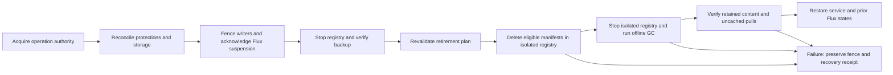

## Context

**Design only, 2026-10-25. No safeguards in this change are activated yet.**
The [operational registry](../../../docs/infra/registry.md) runs Distribution 2.8.3.
A fresh host inspection found 101 MiB in its directory, on the 150 GiB root
filesystem with 115 GiB available. Its 50 GiB `puni-retain` PVC uses local-path;
all three installed StorageClasses use the same provisioner and no CSI driver is
installed. The request is not a capacity boundary. There is no automatic image
retirement; registry backups currently retain all snapshots.

Dagger publishes tiers directly and writes the latest `release.json` only after
all succeed. That partial tier record is not a durable release history. Registry
copy already traverses manifests and checks blob digests. Kubernetes releases
have durable transaction journals; Compose swaps retain exact outgoing digests.
The backup runner already proves root and platform Flux suspension before stopping
the registry. Reuse those boundaries; do not infer protections from running Pods.

## Goals / Non-Goals

**Goals:** bounded registry writes, predictable retirement, preserved deployment
and recovery obligations, and an implementation plan covering every registry writer.

**Non-Goals:** product migration in this delivery, live image deletion, changing
unrelated Flux stages, registry high availability, or unlimited release history.
Registry limits do not bound Docker, containerd or Dagger caches on other hosts.

## Decisions

### Capacity and thresholds

Use a dedicated block-backed filesystem, maximum 50 GiB, exposed through a retained
PV with enforced backing capacity. The implementation must provision and verify
that storage; existing local-path classes do not qualify. Match filesystem identity,
mount, capacity and node ownership before writable startup. Refuse missing mounts;
never create registry directories on the underlying root filesystem as a fallback.
A quota-backed implementation requires equivalent saturation and missing-quota
proofs before substituting for the dedicated filesystem.

Let C be the smaller of configured maximum and actual usable filesystem capacity.
Read allocated filesystem bytes and free inodes, including upload staging and
metadata; do not sum advertised image sizes or count shared layers repeatedly.

| Condition                                                                         | Required behavior                                |
| --------------------------------------------------------------------------------- | ------------------------------------------------ |
| Used bytes >= 70% C or inode use >= 70%                                           | Warn with measured remaining capacity            |
| Used bytes >= 80% C or inode use >= 80%                                           | Request retirement; nightly retirement also runs |
| Used bytes + reservations + new publication envelope >= 90% C                     | Refuse that publication before upload            |
| Actual usage or inode use >= 90%, host root free < 20 GiB, or measurement invalid | Fence new writes and report the exact reason     |
| Usage and inode use < 70%, root reserve restored, maintenance verified            | Permit explicitly reconciled reopening           |

The remaining 10% is recovery headroom, not extra publishing capacity. Pressure is
checked every minute and synchronously at publication admission. The hard filesystem
boundary remains effective if the process or monitoring fails. A polling cutoff is
not an exact physical 90% cap: existing in-flight or out-of-workflow pushes can
overshoot until fenced. They still cannot escape the filesystem boundary. Current
htpasswd authentication has no per-account push restriction; do not claim otherwise.

The startup guard samples the derived write permission before and after hashing
canonical journal bytes. Each sample validates file identity metadata, complete
bounded record syntax, current boot and the thirty-second interval. The final
sample reads uptime after hashing and must authorize the observed checksum. A
matching final sample permits writes even if the initial record changed. The
initial permission never substitutes for a missing or invalid final sample.

Retry a complete sample only when both permissions are valid, their records differ
and the final permission does not authorize the measured checksum. A stable
mismatch refuses immediately; three such unproved attempts select read-only mode.
Missing, unreadable, malformed, revoked, expired or wrong-boot permission and a
failed checksum command refuse immediately. The retry cap remains three.

Normal authority preparation authorizes the current and next journal hashes after
capacity measurement under the canonical lock. Explicit reopening authorizes only
the next hash; a fenced replacement revokes permission before replacing the journal.
The final validated grant therefore determines whether the sampled checksum is
allowed. Requiring byte-identical records also rejected compatible updates during
ordinary publication, as the HOST33 exhaustion trace demonstrated. This correction
does not renew permission or change explicit reopening and readonly
request/instance/nonce acknowledgement obligations.

Initially admit one publisher/import at a time. Before transfer, obtain a conservative
upper bound for all exported OCI content plus upload staging and metadata, without
assuming deduplication savings. Bound export scratch storage separately on the
builder. A missing byte/inode envelope is an admission error. The aggregate reserved inode
envelope must also fit below the 90% inode threshold. Recheck actual capacity
at each artifact boundary; oversize attempts fail visibly and are reconciled as
partial publications. Reservations survive worker crashes until server-side uploads
are quiesced; lease expiry alone cannot authorize reuse of their capacity.

### Protection authority and workflow contract

Add a durable registry journal behind `tool-fleet`, with pure policy planners and
thin host IO adapters. Runtime authority belongs to Twilight Dash's execution
boundary; Twilight Burokrat can validate configuration and evidence, not authorize
runtime deletion. Deploy and publish callers use one authenticated operator boundary
rather than directly editing journal files. Initially this boundary is an owner-only
Bun CLI invoked over the existing authenticated SSH operator path; no new public
service or registry authentication scheme is required.

Journal records contain registry identity, monotonic revision, product, operation,
owner, exact repository/digest references, publication receipt times, complete release
bundles, protection reasons, bounded publication reservations and maintenance phase.
Writes are atomic and durable before acknowledgement. Use a separate bounded 1 GiB
journal filesystem with its own 90% refusal threshold; registry ENOSPC must not
prevent recording a failed operation. Compact only reconciled historical records,
never current protections, recovery records or unresolved operations. Back up the
journal with the matching content snapshot.

| Workflow                           | Obligation before making an image reference usable                                                                        | Safe release of protection                                                                  |
| ---------------------------------- | ------------------------------------------------------------------------------------------------------------------------- | ------------------------------------------------------------------------------------------- |
| Publish / mirror / import          | Reserve space; register candidate digests and dependencies; verify upload; persist complete bundle before success receipt | Reconciled failure or abandonment starts seven-day retention; promotion transfers ownership |
| Promotion                          | Protect the complete candidate bundle before changing desired environment revision                                        | Transfer to deployment and release-history owners atomically                                |
| Deploy / restart / scale from zero | Protect desired, observed and candidate images before changing workload intent                                            | Candidate and outgoing protections remain through health verification and commit            |
| Rollback                           | Protect target and current release before initiating rollback                                                             | Current plus two previous successful environment releases stay protected by default         |
| Failed deployment / recovery       | Preserve every image named by incomplete journals and recovery instructions                                               | Explicit reconciled recovery, never a timeout or a terminal error label alone               |
| Environment retirement             | Prove desired references removed, consumers gone and rollback/recovery work settled                                       | Release that environment's protections only; other owners remain                            |
| Operator pin / restore             | Record attributable owner and reason before promising recoverability or serving restored content                          | Explicit owner release after inventory reconciliation                                       |
| Backup / image retirement          | Acquire common operation authority and reconcile all protections                                                          | Release maintenance ownership only after verified completion                                |

Registered consumer adapters inspect desired Git/Flux images, Kubernetes workloads
including scaled-to-zero controllers and jobs, live releases and recovery journals,
Compose active and idle colours, and solver/worker image locks. Every external product
pipeline must enroll before adoption. A successfully running cached container does
not prove its image can be deleted. Inventory is complete only if every registered
consumer reports against the current operation revision. Unknown owners or digests
freeze retirement until enrolled or explicitly reconciled.

Protect-before-reference is a protocol: a workflow commits its protection before
writing desired state or starting a consumer. Retirement holds the common authority
while checking and deleting; protection changes cannot interleave. Long deployments
hold durable protections, not a host lock throughout the rollout. An operation trying
to add or change references during maintenance waits or fails before touching the
consumer. An admin bypass is outside the supported workflow and must be reconciled
before automatic deletion resumes.

### Retirement policy

Keep the newest ten successfully promoted complete release bundles per product,
ordered by trusted promotion receipt (stable operation ID breaks timestamp ties).
Keep all image protections in addition. Per-environment current plus two prior
successful releases are an independent minimum, even if older than the global ten.
An older successful bundle is eligible once outside both sets. A never-promoted
publication is eligible seven days after its reconciled completion or abandonment.
Do not use image-authored timestamps, mutable tags or process age as authority.

Retire eligible bundles oldest first, then their now-unreferenced manifests. Shared
manifests and blobs remain if any retained owner needs them. Nightly retirement removes eligible content outside the retention policy even when
usage is low. Pressure-triggered retirement runs at the 80% threshold, targeting
usage below 70%. If there is insufficient eligible content,
report the protected bytes and owners; wait for capacity or explicit owner retirement.
Never shorten rollback guarantees just to make a cleanup pass succeed.

Compute the transitive closure of indexes, platform manifests, configs and layers,
including untagged manifests. Repository tags/catalog alone cannot enumerate all
stored manifests: reconcile the publication journal with a read-only census of
manifest revisions in the pinned Distribution storage layout. Unknown revisions or
unsupported artifact/referrer relationships stop retirement until modeled. Validate
content digests and reverse references before selecting deletions. Default GC must
not use `--delete-untagged`, because untagged platform manifests can be required.
Stale upload staging is reclaimed only after its owner is reconciled and no writer
can resume it; age-only upload purging cannot race with admitted uploads.

### Maintenance sequencing and failures

Publication, backup and retirement share one host operation lock plus durable
operation ownership and phase. Refactor backup orchestration to use that same
authority, avoiding nested acquisition of its existing standalone lock. Every run
verifies pinned registry binary, PVC UID, mount identity, node, journal revision and
exact Flux ownership. A dry-run plan records these identities and exact eligible
manifest digests; any changed identity or revision invalidates the plan.

Withdraw the private endpoint, acknowledge root then platform Flux suspension and
stop all production registry processes. Prove no other writer mounts the store.
Create and fully verify a consistent backup of storage and the matching journal.
Run a loopback-only maintenance instance of the same pinned Distribution binary,
with deletion enabled and no external endpoint. Delete only planned eligible
manifest references through its API, then stop it and run offline GC. Never remove
blob directories directly. A maintenance restart resumes the recorded phase rather
than repeating deletion from an outdated list.

Verify all retained manifest/blob digests, an uncached representative pull for each
retained manifest platform, actual reclaimed bytes, free inodes and journal health.
Restore the previous Flux flags and registry service only after this verification;
preserve the pressure write fence if usage remains over policy. A failure before
any destructive action can restore the previously verified store. Once deletion
begins, failure leaves writes fenced and an exact recovery instruction. Restore into
a new bounded volume from the verified snapshot; do not overwrite the only copy.
Reconcile current protections with the snapshot before serving a recovered store. Writable startup reads the durable fence, and the
Flux-owned startup/configuration path must respect it; a temporary replica patch
alone does not establish persistent fencing.

Maintenance intentionally interrupts pulls. This matches the existing consistent
backup model and avoids relying on a TCP proxy to filter HTTP methods. A future
availability improvement needs its own verified writer-exclusion mechanism.

### Backups and monitoring

File/object accounting and transport: [backup accounting research](../../../docs/findings/registry-backup-accounting.md).
Source/new-content and prune resource envelopes: [source and workspace bounds](../../../docs/findings/registry-backup-workspace.md).

Live storage reclamation does not reclaim older restic snapshots. Use seven daily
and four weekly snapshots, with the last verified snapshot and explicit recovery
pins retained regardless of age. Treat those counts as minimum recovery coverage:
if they do not fit, block and alert rather than silently weakening the policy.
The initial backup budget is 100 GiB (107374182400 bytes), configured separately
from C. Per the user's 2026-11-04 clarification, this bounds stored file/object
sizes, not provider billing. Sum the listed sizes of every object version and
uploaded multipart part within the repository prefix. Restic pack, index, snapshot
and lock files count by their stored size. Delete markers add no file payload;
provider metadata charges, minimum billable sizes and billing rounding are excluded.
A Hetzner billing contract is not an admission prerequisite. Before a
backup, reserve a conservative upper bound for new unique content, repository
metadata and prune/repack workspace. If that envelope does not fit, first prune
only already-eligible snapshots while preserving required coverage. If still short,
block backup and destructive retirement and report the capacity decision required.

Retention groups by the stable registry identity across storage-path changes. Select
the latest exact snapshot per represented UTC calendar day (seven newest day
buckets) and Monday-based UTC calendar week (four newest week buckets), then union
the last verified snapshot and explicit recovery pins. Preserve sub-millisecond
timestamp ordering. Missing daily/weekly coverage is explicit: preserve every
existing snapshot and offer no deletion candidates until both minima exist;
separately admitted backup creation may build coverage. Counts describe represented
recovery periods, not an assertion that missed backups occurred.

Root-only, hash-pinned backup configuration stores the explicit full recovery-pin
IDs, including an explicit empty list. Pins are bound to its immutable repository
identity; absence is not an empty-list default. A retention read verifies every
pin and last-verified identity against the complete authenticated snapshot set.
List the entire restic repository without host/path filters, reject foreign or
unreadable records, and match it to stable complete S3 snapshot-version bookends.
Normal restic locking itself writes provider content, so retention inspection
requires prior physical admission/reservation. It grants no permission to prune.
Prune remains a distinct owned, budgeted effect after repository/raw-lock checks
and durable exact-ID retention evidence; repeated admission callbacks never prune.

Source capacity bytes are not a logical or metadata envelope. Distinguish
repository inspection admission (normal-lock writes only) from snapshot admission,
which additionally requires a bounded contents-metadata census. Preflight precedes
the writer fence and cannot assume stable source metadata. Observe both contents
roots only at the stopped snapshot boundary, bind operation/registry/storage,
journal revision/census and exact root identities, then revalidate source and held
authority after admission immediately before backup. Independent writer exclusion
remains mandatory throughout the copy; repeated observation alone cannot replace it.

Required root-only source limits independently bound per-root logical bytes,
entries, depth, fanout and raw metadata. Traverse incrementally without following
symlinks; count every hardlink path, preserve raw names/targets/attribute bytes,
and refuse missing/unreadable/changed/cross-filesystem/unsupported entries. Read
complete caller-visible xattrs within the remaining metadata allowance, never
turning failed observation into an empty list. Linux enumeration may omit
inaccessible namespaces; independently proved full reader visibility is still
required before complete encoding/physical admission. Ignore observer-induced atime drift, which the
fixed backup command does not preserve. Deterministic source hashes cover the
observed metadata, not an inferred physical bound. Source observations explicitly
exclude still-unproved restic ancestor/account-name/serialized-tree/encryption/retry and
workspace envelopes; those must compose with complete object-size accounting before admission
can open. No caller-supplied capacity sum represents maximum new physical bytes.

Durable effect consumption is separate from physical admission. Bind one operation
to repository/scope, root configuration/profile and canonical attempt lineage; an
inspection binding contains no stopped-source hash, and its one snapshot transition
additionally binds the exact immutable observation/revision/census. Canonical recovery
rotates the operation token: bind token hashes to exact current attempt/reconciliation
lineage, while stable operation/repository/configuration/profile identity persists.
A strictly newer validated canonical attempt may use the rotated token; an existing
attempt with token drift and all stale ports refuse. Repeated admission or token
rotation cannot refresh slots, replace a source binding or refund liabilities.
The current provider adapter remains closed until complete physical evidence exists.

Store bounded effect state in a root-only `backup-effects/` sibling of `contents/`
on the existing journal filesystem; see [ADR 0078](../../../docs/adr/0078-registry-backup-consumption-survives-content-restore.md).
Only explicit enrollment of fresh backing creates the vacant state exclusively
and durably. Runtime and provisioning convergence both refuse loss of established
state, lock or the entire sidecar directory; absence never proves first enrollment. Enforce a 1 MiB serialized record and 1,024 effect-entry cap,
old/replacement coexistence and canonical journal replacement/failure headroom
from fresh whole-volume byte/inode observations. No automatic history truncation,
time release, host-root spool or recreation from restored backup contents.

Each fixed restic call site and exact-version recovery deletion requires a
one-use ticket bound to the current canonical attempt/reconciliation and exact
effect identity. Under the held common authority, a short sidecar lock serializes
read/compare/persist even across callers sharing an inherited authority descriptor.
Persist consumption and sync file plus directory after final source reobservation
and before spawn/DELETE. A post-consumption failure or absent terminal acknowledgement
leaves uncertainty and cannot replay/refund the ticket. Pre-publication failures
prove no launch and either durable cleanup or refusal on unresolved replacement;
they are not falsely described as a published spent ticket. Terminal success
requires child/output/cleanup completion and exact matching settlement, without
crediting provider writes or changing captured contents.

Root-only sibling provisioning is staged. This work must not weaken restricted
worker exposure or substitute modeled access for installed/native proof. The
exact-lock recovery path retains its existing dead-origin, full-census and exact
disappearance requirements and gains its own durable deletion consumption; it
never authorizes normal lock-writing commands, forget or prune. Re-inspection of
surviving locks binds exact version plus deterministic validated current-census
hash: a changed view consumes another bounded slot, while identical-view replay
remains spent. A new operation
cannot recycle outstanding/uncertain liabilities; physical release still requires
the missing complete post-operation reconciliation evidence.

Measure repository objects, applicable noncurrent object versions and unfinished
multipart uploads using their listed payload sizes. Configure any bucket lifecycle
only after proving it preserves restic references and other backup prefixes. A
logical restic snapshot size is not the stored repository file total. The 100 GiB
admission budget is an application limit on that total, not a provider hard quota
or billing cap. Incomplete object/part listings or unknown additions still block
new backup admission; missing billing-overhead rules do not. Bounded local backup caches and
scratch directories must be budgeted separately; do not spool a second full registry
copy onto host root. Failed backups preserve the prior verified success receipt.

Expose bytes, inodes, reservations, protected/eligible bytes, blocked reasons,
backup age and last successful maintenance. Each alert includes registry identity,
measured capacity and the remedy (retire an owner, repair inventory or increase
capacity). Test warning, cutoff, failed cleanup and backup failures through the real
notification destination. An independent monitor alerts after five minutes without
pressure reports. A systemd failure alone is not verified alert delivery. Existing
suspended platform alert stages remain suspended until their separate activation.

### Fresh local pressure reporting prerequisite

Preserve the ten-second authority renewal and unchanged healthy canonical journal.
Capture the actual successful check's capacity through its measurement port, without
changing the authenticated command response. Publish a validated bounded observation
on startup, pressure/fence transitions and at least once per minute. Bind identity,
boot, observation time, sequence and canonical semantic snapshot hash; no cached
measurement may acquire a new measurement time.

The first integrated status slice uses a volatile cache at
`/run/puni-registry-pressure/report.json`, provisioned by the existing pressure unit's
owner-only RuntimeDirectory. Two fixed files hold at most 16 KiB each, with validated
allocation and inode headroom; unknown entries and unresolved replacement refuse.
An installed directory missing or unreadable is an error. A valid empty runtime
directory is explicitly never-reported. This cache is not durable notification state.
It stays outside both captured roots and introduces no journal sibling.

Status reads one bounded, fully validated atomic canonical snapshot without taking
the command flock or gaining mutation authority. It joins a report only on matching
identity, revision and semantic hash. Old, previous-boot or mismatched observations
remain stale/unavailable. Physical protected/eligible bytes, physical backup usage
and absent completion evidence remain explicit unavailable dimensions. Existing
verified backup timestamps retain their original age.

Reservation status contains count, byte/inode totals and entries from the fully
validated canonical state; its enforced zero-or-one reservation invariant preserves
safe-integer arithmetic. Backup verification retains original registry/storage/path
identities beside the current/historical classification. Report ordering and future
refusal compare epoch time, including expanded-year canonical ISO timestamps.

Canonical publication, pressure and maintenance receipts use the same chronological
rule. Persisted backup, retirement, deployment and reclamation provenance compare
accepted instants numerically; wire strings and each existing schema remain unchanged.
This restores existing chronology guarantees without narrowing accepted year formats.

Installed durable delivery spooling, the actual configured destination, independently
hosted five-minute missing-check delivery, cleanup/backup notification outcomes and live
receipts remain required before Task 5.1 completion. Local status and process tests
cannot satisfy destination delivery. No unit activation is part of this prerequisite.

### Source alert capture and delivery prerequisite

The local source pipeline connects actual pressure and maintenance entrypoints to
a persistent outbox and sender CLI. Capture precedes replaceable report publication
and retry clearing durable failure. Periodic sender ticks recover uncaptured durable canonical failures before deciding
delivery is idle, without requiring another maintenance invocation or repeating its
effects. Network IO stays outside the authority renewal loop. Critical incidents retain their first evidence through healthy samples,
restarts and uncertain requests. Owner scope, omitted counts and unavailable physical
census remain explicit; local receiver tests cannot satisfy real destination proof.

A pressure episode ends only at an observed normal, unfenced state. Moving between
warning and cleanup pressure cannot rearm an acknowledged warning; each threshold's
first occurrence remains distinct, and ending an episode does not erase undelivered alerts.

The candidate store has 32 event slots of at most 4 KiB each, including one reserved
critical slot. Current/pending snapshots are at most 256 KiB each, fault records
4 KiB each. Fixed state/send locks separate short state transactions from the
request lifetime. Runtime requires explicit immutable pre-enrollment, stable lock
identity, strict fixed-file/schema bounds and actual filesystem accounting. The
selected dedicated profile caps the filesystem at 16 MiB and 4,096 inodes and
retains replacement, allocation and 64 KiB metadata/failure headroom. No root-filesystem
fallback or missing-state genesis is permitted. Native provisioning/format/ownership
proof remains required before activation; modeled test counters do not establish it.

Snapshot replacement retains pre-existing refusal evidence through every
commit-critical IO operation. After syncing and renaming the new JSON, the vacated
`pending.json` slot becomes a second bounded marker while `fault.pending` still
protects the transaction. Its content, directory entry and descriptor are settled
before removing `fault.pending`; the existing final directory sync occurs while
`pending.json` still blocks readers. Publication descriptors close before the last
marker is released. Final `pending.json` unlink must succeed, but persistence of
that cleanup is not a commit requirement: the snapshot is already durable, and a
marker reappearing after a crash causes conservative refusal. There is no required
unprotected sync after that last unlink. Regaining directory write permission
alone cannot resolve an uncertain replacement. This uses the same six file names
and allocation bounds; it does not rely on allocating recovery evidence after IO
has already failed.

One explicitly configured conditional Slack incoming-webhook adapter is staged,
without claiming that it matches the installed destination. Three persisted attempts
and a ten-minute horizon survive restart. Requests have a ten-second deadline,
8 KiB request and 4 KiB response limits, no redirects and at least one-second spacing.
Exact HTTP 200/body `ok` is protocol acknowledgement. Valid Retry-After is respected
within the remaining horizon; correctable rejection and uncertain network/ack outcomes
retain bounded failure state. Credential/destination changes cannot reuse stale success.
Only the sender receives the selected secret reference; no URL enters logs or state.

Actual destination, independent-host acquisition and observer remain unselected.
The installed status CLI's UID59001 requirement does not create remote authentication.
The full five-minute independent path, real warning/cutoff/cleanup/backup receipts,
complete protected-owner evidence and host/native checks remain Task 5.1 obligations.
This local prerequisite adds no remote/root route, root helper verb, platform stage
activation or product migration.

## Risks / Trade-offs

The newest ten releases may exceed 50 GiB. The system chooses blocked publication
over lost rollback. Conservative reservations can reject uploads that would deduplicate;
this is preferable to spending unproven savings. Offline GC causes downtime and its
full closure verification grows with retained contents. Storage remains single-node;
a hard bound does not create replication. Current registry-wide credentials permit
operator bypass, so physical limits are the ultimate space boundary. Snapshot
retention protects recovery but does not promise indefinite republishing of retired
images. Operator recovery pins can consume both budgets indefinitely and must remain
visible. Separate limits are required for build caches, node caches and host logs.

## Migration Plan

1. Implement journal, admission and non-destructive inventory. Enroll current proof
   images and every consumer. Run retirement planning only; unknown ownership blocks it.
2. Provision and prove the bounded storage and journal filesystems. Back up the old
   store, fence writes, copy, verify every digest and uncached pulls, then switch the
   retained PV. Preserve the old PVC for rollback; measure temporary migration space.
   Rollback after new writes requires a new consistent copy, not switching to stale bytes.
3. Activate alerts and cutoff proofs, then enroll publishing and deploy adapters.
   No existing product reference changes in these steps. Verify wrong/missing mount,
   quota exhaustion and monitoring failure on isolated fixtures before host rollout.
4. Reconcile dry-run retirement with retained releases and real consumer inventory;
   run the protected deletion, concurrency, crash and restore drills on a disposable
   registry with the deployed binary. Activate scheduled retirement only after these pass.
5. Mark product registry adoption ready only after exact-revision gate evidence and
   live cutoff/protection/restore receipts. Configure Dagger DNS/trust and migrate
   product images in the separate adoption workflow. Keep unrelated platform pins.

## Open Questions

No unresolved policy choice blocks this design. Implementation must discover and
record a suitable dedicated volume allocation, actual usable capacity, backup object
accounting and real alert destination before activation. Missing provisioning,
credentials or notification delivery is a visible activation blocker; it is never
permission to fall back to unbounded storage or unverified notifications. These
facts are not asserted by this design-only delivery.

## Primary references

- [Local-path capacity limitation](https://github.com/rancher/local-path-provisioner#cons).
- [Distribution garbage collection](https://distribution.github.io/distribution/about/garbage-collection/).
- [Distribution configuration](https://distribution.github.io/distribution/about/configuration/).
- [Restic retention and pruning](https://restic.readthedocs.io/en/stable/060_forget.html).

Implementation must verify behavior against the deployed Distribution and restic
versions, not assume current documentation proves compatibility.

### Installed selection cannot be erased by environment variables

Task6 replaces the optional-selector boundary for installed publication, copy and
consumer-mutating entrypoints. Every execution host must have
`/etc/puni/registry-deployments.json`: canonical root:root regular file, mode0644,
single link and at most64KiB. Missing, unreadable or malformed catalog refuses
execution. An explicitly installed `{ "schemaVersion": 1, "managed": [] }`
establishes an unmanaged host; absence never does. This is a tool-installation
prerequisite, not product migration. Task11 installs the complete mapping before
rolling out these entrypoints.

Each managed entry pins normalized registry `authority` (host and optional port),
`registryId`, `product`, `environment`, immutable execution `target`, and
`enrollment: {path, sha256}`. Optional `publication: {path, sha256}` pins the
publication contract for that product. Paths are absolute trusted enrollment files;
SHA256 is over UTF8 `JSON.stringify` of the parsed enrollment. Catalog identity
must match the enrollment's registry URL, registry ID, product and (for deployment)
environment and target. Duplicate mappings refuse. A managed registry without an
applicable publication entry refuses publication; it cannot become a legacy push.
Environment variables select among matching pinned entries only. Unsetting them
cannot suppress catalog-required management or permit a downgraded local recovery
journal to mutate consumers.

Existing successful history enrollment accepts only complete ordered IDs of
already-promoted journal bundles, preserving their receipts. Pre-authority product
history that cannot prove this contract is not adoptable by this change. Fresh
first-install enrollment is explicit. Upgrading authority schema1/2 to3 is an
explicit fenced operation; no live upgrade is performed here. Deployment journal
writer4 and first-start writer3 retain legacy unmanaged readers (3 and2 respectively)
but managed recovery requires exact operation and reference bindings. Recovery
lineage preserves interrupted ancestors until verified successful reconciliation.

### Source-owned history, host coverage and completion receipts

The [installation and recovery contract](../../../docs/infra/registry-consumers.md)
defines the fixed catalogs, artifact pins, source access, explicit initialization
and transfer procedures. The authority remains the only registry journal writer.
A versioned JSON lifecycle bundle lets the private product reuse public admission,
export and receipt logic without a sibling-source runtime dependency or a copied
private authority. Source-owned reader bundles avoid a new shared contract project
and dependency cycle while retaining each owner's strict parser. Fixed authenticated
SSH transport makes source access explicit where authority UID59001 cannot read
product-host state; installed transport access is an activation prerequisite.

Reader protocol registry-consumer/2 distinguishes actual references from successful
history evidence. Complete ordered history includes a canonical evidence digest of
bundle IDs, sorted exact references and original promoted receipts. Empty history
requires explicit validated genesis, never a missing file. Owning journals persist
history after verified authority promotion, preserve sealed first-start inheritance,
and refuse bounded-capacity overflow. A lost persistence acknowledgement blocks new
ownership/retirement until read-only existing-operation resume repairs the original
receipt. Resume never creates, promotes, reconciles or releases an operation.

Historical evidence does not permanently root completed images. Actual desired,
runtime, idle and rollback readers provide live roots; environment protection keeps
current plus two prior successes and unresolved recovery ancestry. History/authority
disagreement blocks retirement. A retired environment releases only its own protection;
its readable control/history sources and other owners' shared references remain.

Docker host scope is explicit: kind docker-host, environment:null, consumer role.
Each Compose actual-consumer source links its complete global host source through
hostSourceId; trusted configuration must match machine/catalog/Docker/transport
identity. The shared root-owned ownership catalog binds exact names and Compose
project/service/working_dir labels to canonical roots and environments. All containers,
including stopped/unrecognized managed refs, remain in global coverage; unknown or
ambiguous ownership refuses. Per-environment projection uses that verified mapping
and root-scoped desired files. Global sources cannot replace environment coverage.
This permits same-host environment retirement and fresh genesis without dropping
another environment's roots or importing its history.

Managed Compose success follows all configured three tiers and the existing shared
smoke within the same whole-environment lock, protecting the complete four-image WBS
publication. Partial selection refuses. Smoke artifact identity is installed before
mutation; failure preserves ownership without auto-rollback. Retry of a fully committed
candidate reruns complete verification/smoke without tier swaps or migrations. Attended
backend diagnostics require an already unresolved full-environment binding and fresh
protection verification; they confer no promotion or reconciliation.

Private Git pin/rollback only persist pending ownership. Exact Flux source/applied
revision, current Ready generations, all three exact-image available Deployments and
existing live checks precede promotion. The private fleet declaration independently
pins accepted authority/repository/service mapping; receipts cannot choose the trusted
allowlist. GHCR logical Kustomize names remain, managed newName is explicit, rollback
preserves complete owner evidence, and current actual pins/holds stay unchanged.

### Reviewed source and publication boundaries

Kubernetes inventory visits every advertised served group version, not only the
preferred version. Unknown populated selectors in any version refuse; duplicate
representations only union their image references. Compose explicitly supports the
existing service-free dev base while requiring a services mapping in every tier.

The private publication child receives registry credentials only for publish-docker,
with loader variables excluded throughout. The private history reader separates
the registered configuration-file identity from its independently pinned owning
Git directory. Both identities and both configuration hashes must match before a
report can join the complete consumer inventory. The concrete fields and installer
requirements are in the registry consumer runbook.

### Authority installation ordering

The authority installer owns the nonsecret maintenance enrollment required by its
ordinary CLI. It stages and hashes the candidate runtime/bundle in a private root
directory and asks that candidate to validate the trusted enrollment's schema
before changing active files. After validation, configuration precedes runtime and
bundle publication. Maintenance staging requires matching installed configuration
and authority bytes and cannot replace that enrollment. Candidate validation has
no journal or host-port effects; full physical/resource readiness remains required
by the separate installed activation drill. A noncached namespace rehearsal runs
the actual Ansible role and its configuration preflight with explicit fault/removal
cases, without treating synthetic resource pins as live ownership evidence.

### Maintenance privilege transport

The fixed UID59001 authority invokes hash/metadata-verified `/usr/bin/sudo.ws` and
one no-argument root helper. A private per-invocation Unix socketpair on standard
FD0 transfers the same already-held canonical flock description using SCM_RIGHTS.
A nonsecret nonce and exactly one descriptor precede any operation token; the helper
verifies the canonical held lock and current sender credentials, then acknowledges
with a fresh challenge and current kernel-authenticated root credentials. Only then
does the authority send its typed action/owner/operation/token. Every packet uses
SO_PASSCRED/SCM_CREDENTIALS; socket creation credentials cannot establish post-sudo
identity. Root maps its received descriptor to FD3 for native descendants, owns
independent deadlines and kill/reap cleanup, and closes without LOCK_UN.

Shared sudo policy must parse with both installed classic and default sudo-rs tools.
It contains no incompatible closefrom/logging settings; PTY or input-log interposition
must fail authentication before receiving a token or causing effects. No pathname,
listener, daemon, reopened lock or second authority is introduced. The rejected
classic-only fragment and transport trade-off are recorded in [ADR0076](../../../docs/adr/0076-registry-maintenance-transfers-the-held-authority-descriptor.md).
Native isolated and final installed privilege/descriptor/cleanup proofs are required
before this contract is considered operationally verified.

### Backup attempt and repository lock recovery

A root guardian's kernel-authenticated ACK PID is an internal capability. Before
sending its single action request, the existing authority durably binds that exact
fresh root PID/start/machine/boot/PID-namespace identity, installed backup config
hash and one-use nonce. The guardian rereads the current canonical revision before
any backup effect. A fixed pinned unshare invocation creates a private UTS namespace
before starting the fixed Bun worker; the worker verifies that namespace and sets
the nonce hostname. Restic's lock hostname identifies the attempt, while explicit
backup `--host` remains the stable registry identity across store rebinds.

The same authority description survives through the worker and non-detached restic
children. Root supervises their one process group; SIGINT has a fixed five-second
restic grace before forced group cleanup. The worker independently observes pipe
EOF and deadline. Failed or unacknowledged effects retain pending lineage and the
write fence. Reconciliation must settle old attempts before new nonces can start.

Fixed backup-reconcile derives all pending identities from canonical state and
requires pre-effect journal/failure-receipt capacity. A mandatory provider port
supplies complete bounded raw visible/history versions, hashes and exact-version
deletion. Hidden history is preserved, every represented key has exactly one visible
latest object/delete marker, and unrelated history consumes census capacity rather
than mutation receipt capacity. Bounds are65,536versions/64MiB metadata with bounded
mutation receipts. Unknown, malformed, unreadable, changed or foreign objects refuse.
Fixed read-only no-lock cat lock/config inspection binds decrypted metadata and
immutable repository ID to unchanged raw versions; all effect commands keep locks.

Independent origin exclusion requires matching machine/boot/PID namespace and proc
mount view, then exact guardian/effect process absence. A different origin or boot
cannot be inferred dead from local proc/network observations. Exact deletion and
complete recensus preserve other versions and refuse foreign content exposed by a
version removal. Terminal root cleanup precedes canonical reconciliation receipts;
partial effects remain failed/fenced. The root S3 adapter uses the exact pinned
official client-s3 SDK with explicit endpoint, scope, region and static credentials;
ambient credential/configuration discovery, retries and redirect following are
disabled. Each signed request rechecks the inherited canonical authority. Strict
XML validation precedes SDK scalar normalization. Pagination consumes supplied
opaque cursors without requiring them to identify a returned entry; scope, echo,
direction, cycle, duplicate and finite count/byte/request checks remain mandatory.
One census cycle shares its cancellation deadline across all lock reads and full
metadata bookends. Exact GET/DELETE identities and terminal cleanup are verified.
Payload totals explicitly exclude provider metadata/minima and cannot admit the
physical budget. The budget port remains closed until that independent bound and
retention/prune/restore proofs exist. Controlled SDK transport fixtures establish
local behavior only; live provider compatibility remains unverified.
The explicit owned-local native adapter proves mechanism only. See
[ADR0077](../../../docs/adr/0077-registry-backup-locks-identify-their-owning-attempt.md)
for alternatives and pinned restic behavior; final installed and independent-host
proofs remain activation prerequisites.

### Actual client pull verification: implementation continuation

HTTP closure/digest verification remains necessary but is insufficient to acknowledge
an uncached client pull. Use the pinned Crane v0.22.1 client to retrieve OCI image
layouts, keeping the shared Docker daemon and its image/cache state outside the
maintenance operation. Its [documented pull command](https://github.com/google/go-containerregistry/blob/v0.22.1/cmd/crane/doc/crane_pull.md)
supports platform selection and OCI layout output. The [pinned implementation](https://github.com/google/go-containerregistry/blob/v0.22.1/cmd/crane/cmd/pull.go)
selects an image when a platform is supplied. The [layout writer](https://github.com/google/go-containerregistry/blob/v0.22.1/pkg/v1/layout/write.go)
can reuse existing blob files, so every verification must have a newly created,
independently empty output directory and no reusable layer cache. A successful
exit alone is insufficient: inspect and hash the produced layout against its
expected selected manifest, configuration, platform and complete blob closure.

This is the implementation choice for the existing required pull proof, not a new
success criterion or proof that the production path is already wired. Replacing
the standalone client is reversible; no ADR or product migration is needed.

The coherent production action follows these boundaries:

1. Complete the existing retained census and HTTP digest checks, then close and
   reap that readonly server before the native pull action starts. One new fixed
   root action runs the existing stopped-writer/controller/mount audit and owns
   a fresh readonly Distribution child, the actual clients, temporary credentials
   and scratch through terminal cleanup. Keep the same inherited authority FD3.
   Do not adopt another helper's listener, omit writer exclusion to accommodate a
   concurrent server, or extend the control channel into concurrent work routing.
2. Derive repository-qualified retained platform coverage from verified physical
   manifests, indexes and configuration blobs. Reuse the physical revision/closure
   checks without executing user-owned consumer readers as root. Bind the canonical
   plan and source census to the parent inventory and current operation/store/
   authority revision. Include untagged children. Reject missing, contradictory,
   ambiguous or unsupported platform metadata instead of choosing a host default.
   The [client platform matching source](https://github.com/google/go-containerregistry/blob/v0.22.1/pkg/v1/remote/index.go)
   assumes amd64/linux for a missing index-child platform; this must not silently
   decide registry verification coverage.
   `collectRegistryStoredContent` reuses the complete physical census without
   executing consumer readers or HTTP. Client planning rejects upload staging before
   opening bodies and rehashes the final census. `planRegistryClientPulls` covers
   every repository-qualified revision, including direct leaves and each index
   platform. The final requested selector must select the expected child at every
   nested edge; features cannot disambiguate Crane's os/arch/variant/os.version flag.
   Scratch envelopes use the measured allocation unit, two allocated copies of
   each unique output blob, 32 metadata blocks/inodes and8MiBmetadata workspace.
3. Supply a private, newly empty cache/output for each planned pull. Pin and verify
   the executable's canonical root-owned artifact metadata/hash, and keep credentials
   out of argv, diagnostics and returned receipts. Put server and clients together
   in private mount/network/PID namespaces with fresh procfs, only loopback connectivity
   and a readonly source bind. The worker requires `/proc/self` to resolve to PID1;
   a private PID namespace with inherited host procfs does not satisfy isolation.
   The outside root launcher inherits FD3 before creating the mount namespace, then
   uses a finite systemd scope. Its kept input pipe carries a bounded namespace-origin
   line followed by the existing fixed authority request and cancellation protocol.
   Identify each visible mount through its descriptor identity; hidden kernel mount entries
   are covered only by a proven different mount outside their parent lineage. Avoid
   root self-binds that create an inactive writable root mount. Before returning root
   completion, the launcher independently compares physical plans and requires the
   owned child groups, pipes and systemd scope to be terminal. Clear proxy/helper/cache environment inputs. Missing tools, namespace
   setup or resource limits refuse instead of falling back to a host cache/listener.
   The pull pool is root-owned mode0711. Root setup holds job/pool directory
   descriptors and uses their anchored paths; the unprivileged client inherits the
   held job as FD4 alongside the authority lock at FD3. Output, credentials and
   temporary paths resolve through its FD4. Verification opens output relative to
   the same held job, and no-follow descriptor-based cleanup closes both handles.
   A writable ancestor must not redirect setup or client writes outside the bound.
4. Establish real byte/inode scratch bounds before downloading. Production capacity
   must accommodate the declared representative-image closure plus temporary files,
   metadata and cleanup workspace, or refuse with writes still fenced. A dedicated
   bounded filesystem is required; a regular directory on host root and a 64MiB test
   filesystem do not establish production capacity. Preserve the root reserve and
   all existing registry/journal/recovery bounds. Admit any backing allocation before
   it is written; use the installed fixed profile and inspect its actual identity.
5. Verify the produced identities and full expected coverage, not merely a zero
   exit or platform counter. Remove and verify each output before the next pull.
   Await/reap the client, readonly server and any namespace worker, and verify
   credential, scratch, mount and process cleanup on every success/failure path.
   Preserve both operation and cleanup failures. Owner death/cancellation/deadline
   must retain the shared authority until owned effects are dead.
6. Only authenticated root terminal completion after cleanup may settle the durable
   pull receipt. Generic session.record must not invent, erase or replace it. Bind
   it to operation, actual store, census/plan, current obligation revision and exact
   platform coverage; require fresh completed evidence before verified phase and
   root service restoration. Apply the same rule to staged recovery and coordinated
   activation using their reconciled target census. Keep the measured reclamation
   sample after client work and before restoration. Legacy journals may remain
   readable without granting the new success gate.

Shared-Docker pulls would reuse cache and host state; concurrent helper/listener
adoption would add cancellation and ownership ambiguities. One sequential root
operation keeps exclusion, process custody and the completion boundary together.
The independent review recommended this path. Installer artifacts/configuration,
protocol action validation, phase/session ownership, ordinary/recovery callers and
native failure proofs must all be implemented and checked before this finding can
be resolved. The successful throwaway probe below establishes tool compatibility,
not any of these production guarantees.

### Durable client attempt and interrupted scratch custody

The outside root launcher publishes one root-private `.client-attempt.json` in
its dedicated bounded pull pool before creating a systemd scope. This is scratch
custody metadata, separate from canonical journal completion: writing it does not
change the inventory's journal revision. The pool is root:root0711; the record is
root:root0600, a regular file with one link, at most8192bytes, on the held pool's
filesystem. Its validated identity binds the operation, registry, snapshot, scope,
source plan/revision/store, installed tool and scratch profile, hashed capability,
actual guardian and pool device/inode. No credential or capability token is stored.
The parent mints a UUIDv4 and derives its exact systemd scope name.

Publication uses Linux `O_TMPFILE`, a complete write and file fsync, followed by
`linkat` into the held directory and directory fsync. There is no named-partial
fallback. An owner killed before publication leaves only an anonymous inode that
the kernel reclaims; no native effect starts until publication is acknowledged.
See the Linux contracts for [open](https://man7.org/linux/man-pages/man2/open.2.html)
and [linkat](https://man7.org/linux/man-pages/man2/link.2.html). Metadata admission
and a fresh stopped-writer/target audit precede allocation. Scratch identity and
bounds must still match the fixed profile and held directory; root reserve stays
at least20GiB. A normal directory on root is not an accepted scratch fallback.

The worker independently derives the plan/profile/token facts, reads the exact
protected record and checks its actual cgroup, boot, machine and nonfuture
one-hour attempt window before starting its readonly server. Empty scratch means
only the ownership record may remain. Successful terminal cleanup requires an
empty pool and the exact scope to be not-found/inactive with no control group
before removing and syncing the record.

A fenced retry may reconcile an interrupted record only for the same operation,
registry, snapshot, scratch filesystem and machine. It first proves that exact
recorded scope terminal, then audits and removes only anchored `pull-UUIDv4` job
roots belonging to the dedicated pool. Recovery handles root setup interrupted
between chown/chmod stages. Unknown entries, missing ownership with nonempty
scratch, unsafe metadata, symlinks, hardlinks or special files refuse and retain
uncertain state. A held pool descriptor prevents renamed ancestors from redirecting
cleanup. Recovery has its own60second deadline. The retry reruns current admission
and target checks, then publishes a fresh nonce; it never reuses the old unit.
Operation and cleanup failures remain observable together. Canonical client
completion is still settled only after authenticated root terminal cleanup.

### Pull storage provisioning continuation

The existing client scratch requirement is installed through an explicit
`registry_pulls` Ansible play, separate from canonical storage and maintenance
artifact enrollment. Byte and inode limits have no production defaults. Dedicated
`provision-pulls`, `mount-pulls` and `verify-pulls` modes create or verify one fully
allocated ext4 backing file, set an explicit format-time inode ceiling, and check
actual bytes/inodes and root:root mode0711 pool metadata. The canonical registry
and journal must verify first; storage directory and root reserve must agree.
The journal owns the pull identity receipt. The pull boot unit requires canonical
storage and precedes backup/retirement. Source pins, installed client/tool profile
verification and the complete lifecycle gate still precede client enrollment.

### Read-only client installation preflight

The authority CLI offers `--validate-client-installation <trusted-candidate>` for
explicit client enrollment. It parses the same root-owned candidate and verifies
all fixed client artifacts with exact mode/root group on their hashed descriptor,
canonical storage receipts, the separate pull filesystem and root:root0711 pool.
Enrolled recovery stores are included. The zero download envelope permits a full
owned pool during recovery-tool installation while retaining physical identity,
byte/inode bounds and separation checks. Validation opens no journal or client job.
The existing `--validate-installation` remains schema-only for authority staging;
legacy absent/unenrolled client manifests remain readable and grant no client action.

The maintenance role installs the eighth client-worker bundle and pinned Crane for
explicitly enrolled clients. Before its privilege grant it runs the storage
helper's canonical/pull verification and the new authority CLI, which remeasures
the configured host-specific tool pins. Successful status and exact acknowledgements
are required. Controller source checks precede host copies; legacy seven-bundle
staging remains explicit. The uncached client installation role rehearsal covers
refusal boundaries and idempotency on disposable enforced storage. The complete
installed lifecycle rehearsal and production enrollment remain pending.

### Restricted process views during writer exclusion

Linux exposes mount tables relative to each process root. OpenSSH authentication
processes can therefore return a valid empty table while alive. Treating every
empty read as malformed makes the maintenance barrier intermittently unavailable;
treating it as unconditional absence can hide writable roots or other tasks.
[readRegistryWriters](../../../tools/tool-fleet/src/registry-maintenance-writers.ts)
owns the isolation conditions and refuses visibility it cannot prove safe. Its
native chroot cases exercise actual filesystem state and writes, including hidden
access through another live task. This keeps the complete writer exclusion
requirement; it does not add an acknowledgement or a bypass for process names.

Storage mount selection must use the held storage descriptor's kernel mount ID,
not pathname ordering: covered and visible mounts can share the same pathname.
For a restricted process, root/cwd device and inode equality alone does not prove
path equality across bind mounts. The accepted privilege profile must also rule
out filesystem-changing capability and privilege regain that could invalidate
confinement. The alias and retained-capability native negatives remain pending;
the existing ten-mode rehearsal does not cover either condition. These are
required writer-exclusion proofs before activation.

Held root/cwd descriptors now establish path identity through exact kernel mount
IDs. The current process profile requires nonzero real/effective/saved/filesystem
UIDs, empty effective/permitted/ambient capability masks and NoNewPrivs. Initial
and final samples are independently validated; bounding/inheritable fields may
retain bits under that profile. NoNewPrivs covers exec privilege gain, not all
retained authority. Empty-view descriptors are therefore classified before storage
filtering, with namespace, anonymous-inode and PID filesystem classes refused.
The current kernel's PIDFS differs from the legacy anonymous-inode representation.
This conservative classification can refuse benign anonymous descriptors; it
never treats unknown authority as safe because it has no current storage FD.
The complete descriptor-authority review and native proof remain pending, and
these source corrections alone do not establish installed readiness.

## Source-stage boundary — 2026-11-08

The complete retained source is staged while ordinary publishAll/copyImage, DeployPlan,
executeRelease, startCutover and runSwaps preserve current-main behavior. Ordinary
journal writers remain schema3/version2 and TierState remains the legacy contract.
The active registry render remains current-main; production/storage-patch.yaml is unreferenced.

Explicit managed helpers retain mandatory catalog selection and source-owned history.
Registry-first-start and registry-journal own managed state; first-start-state and
journal-state share only sealed request, receipt, migration and replay validation.
Baseline parsers enforce their original versions before common validation. No second
coordinator, automatic upgrade, initialized history, selector fallback or default hook
is introduced. ComposeRegistryPlan and RegistryTierState name dormant ownership.

Before switching supported routing, complete the outstanding coordinated caller,
physical/native, provider, backup, isolation, delivery and restore acceptance. The
exact-revision host gate remains required before deployment/adoption; source readiness
requires actual owning source checks and current-head CI, without a duplicate host gate.
Original integrated prototype/evidence remains at e347fbf7adf555e75259ad520ffe7eef25e2a1b4.

Source CI preserves the ordinary fleet test prerequisites in both ci.yml's selected
workspace shard and infra-check's fleet-check job. They invoke one shared CI-only
compiler/user-namespace preparation helper before fleet tests. The workspace's exact
fleet/full selector and unrelated Twilight profile remain unchanged. Both infra
workflow event filters include helper-only changes. This provisions no target host
and invokes no registry installer or stopped privileged proof.

### Fixed S3 request retry profile

Every staged S3 Restic command uses `--no-cache -o s3.retries=1` through one
fixed profile descriptor shared by the actual child launcher and the existing
effect fingerprint. Local-file fixtures preserve their prior `--no-cache`
arguments. The setting limits the MinIO request loop to one attempt; it preserves
Restic's enabled backend-error redesign, outer retries and existing deadlines.
Changing the bound descriptor must refuse established mismatched effect history
rather than resetting it. This supplies one execution-profile input, not complete
object-length, lock-write, memory/scratch, reservation or admission evidence.
The production physical-admission adapter remains closed until those compose.

The retry prerequisite is exercised through the actual store and pinned child
against an ordinary owned TLS receiver: two selected-key commits lose replies,
then the third succeeds with identical encrypted bytes and two outer Save retries.
Omitting only the option restores zero outer notices and fails the completed
observation. Signature checking and DELETE are protocol models, so this does not
certify provider accounting. Ordinary modeled root-action fixtures persist the
independently expected S3/local fingerprints using real owned effect state and
refuse descriptor drift without resetting history. Installed root execution and
the stopped privilege/descriptor campaign are excluded.
